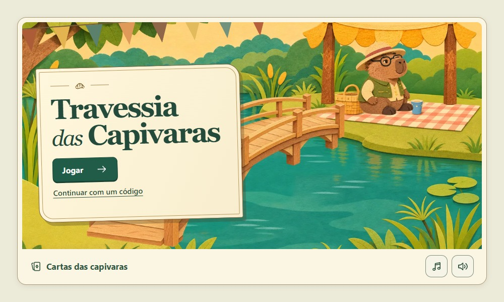
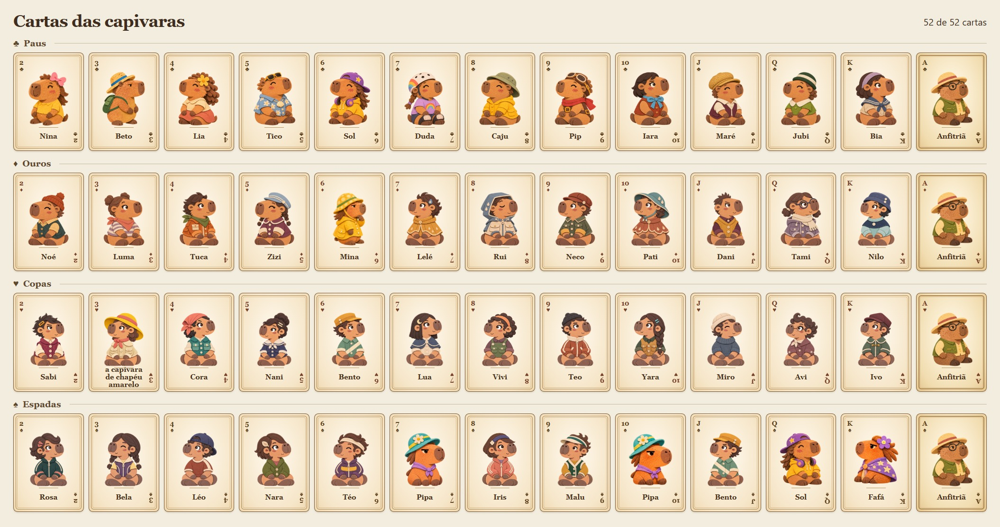
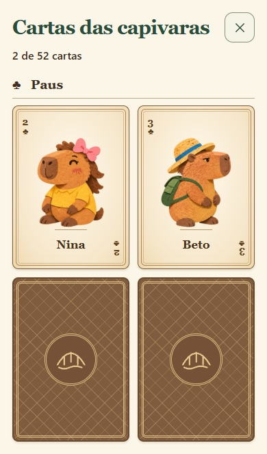

# The picnic invitation and the capybara deck

**Implementation handoff · November 27, 2026.** Ready for GPT-6.2 Sol at **High** when the owner asks to execute. The owner has tested the current game end to end. Use that build as the behavioral baseline. The three design sheets below are previews of the proposed interface.

## Who does what

OpenAI recommends Sol for feature work, Terra for visual inspection and Astra for demanding engineering analysis. Its Codex guidance favors independent assignments with clear outputs and cautions about overlapping edits. The roles and effort settings below are project choices. **Before editing**, Sol should confirm available agents and assign the paths below. [OpenAI model selection](https://developers.openai.com/api/docs/guides/model-selection) · [OpenAI Codex subagents](https://learn.chatgpt.com/docs/agent-configuration/subagents)

| When | Model and effort | Assignment and return |
| --- | --- | --- |
| Throughout | **GPT-6.2 Sol · High**, lead | Own the entry flow, shared files `index.html`, `main.js`, `style.css`, package test command, integration and final acceptance. Give each child the plan path, its inputs, write scope and acceptance cases. |
| Step 2, in parallel | **GPT-6.2 Sol · Medium**, title and controls | Build the picnic invitation and the visual treatment for the two native audio inputs in dedicated title/control files. Return mount points, scoped styles and responsive behavior. Lead wires events and IDs. |
| Step 2, in parallel | **GPT-6.2 Sol · Medium**, deck | Own the deck catalog, read-only album renderer, scoped CSS, small runtime portrait exports and catalog tests. Return the 52-card inventory, source checks and a way for the lead to open/refresh the album from a checkpoint. |
| Step 2, in parallel | **GPT-6.2 Sol · High**, audio | Own `audio.js` and focused audio tests. Implement ducking against the existing cue queue, including interruption and failure recovery. Return measured levels/timings and checks. |
| Step 4, in parallel | **GPT-6.1 Terra · Medium**, visual QA | Inspect the running build in desktop and phone layouts, compare with the three sheets, exercise keyboard/focus, and inspect all faces against source. Return observed defects with viewport, game state and screenshot. |
| Step 4, in parallel | **GPT-6.2 Astra · Medium**, integration reviewer | Read the integrated diff and test results. Trace startup/restore, checkpoint ownership and audio callbacks. Return concrete regressions or missing cases with file references. Lead owns fixes. |

Use at most three children alongside the lead. Finish implementation agents before reusing slots for review. In this desktop environment an explicit child model/effort uses `spawn_agent` with `fork_turns="none"`. Supply the checkout path and the specific brief in that call. If a prescribed model is unavailable, use an available Sol for the assignment and record the substitution. Follow the workspace local-worker policy for bounded proposals when worthwhile. Keep integration and acceptance with the lead.

## What the player sees

### A picnic invitation

The first visit opens **Travessia das Capivaras**. The existing pond painting supplies the bridge, the host in glasses and the checked picnic blanket. Hang a short string of paper pennants along the top edge. Set a cream, double-ruled invitation on the left bank with a large Georgia title, one forest-green action and the restore link underneath. Keep the host and the far end of the bridge visible. On a narrow phone place the invitation below the picture in normal flow. All words and actions are live HTML. A still composition works at every motion setting.

| Entry | Primary action | Destination |
| --- | --- | --- |
| Fresh load, checkpoint 0 | **Jogar** | Existing first crossing, via one click |
| Fresh load, checkpoint 1–47 | **Continuar** with the next crossing identified nearby | Existing `start(checkpoint)`. Also expose the existing earned replay choices on this entry screen. |
| Fresh load, checkpoint 48 | **Ver o lago** | Existing completed pond, six group close-ups and replay menu |
| During a session | Existing landing **Continuar** | Existing next-crossing hub or finale directly |
| Manual code or QR fragment | Existing preview, confirm and cancel | A valid fragment takes precedence on load. Confirm uses the existing restore destination. Cancel returns to the prior screen/attempt. Keep malformed-code feedback visible. |

Place **Cartas das capivaras** with a small stacked-card icon in a consistent, visible utility row on the title, next-crossing hub, active question, landing and finale. Keep the two sound controls alongside it. During a question, the row sits outside the evidence and answer area. The existing save panel, QR, copy, restore and confirmed start-over stay reachable. The title is a page-entry presentation, never an extra stop between crossings. Opening the title or album is silent.

### One playing deck, four suits

There are **49 characters by game identity**. The 48 earned traveler IDs each have a seat. The original picnic host has a separate, permanent seat. The deck depicts that same host on four aces for a total of **52 cards**. B1-10 uses its established description. Pipa, Bento and Sol recur under different crossing IDs, and Teo and Téo keep their distinct spelling.

Read each row left to right as **2, 3, 4, 5, 6, 7, 8, 9, 10, J, Q, K**, followed by the host ace. Group headings and corner pips identify the suits. The portrait caption is the in-game name. Use **Anfitriã** as the host's role caption and announce the ace's suit.

| Suit | Crossing ordinals | Traveler captions in rank order | Host ace turns up |
| --- | --- | --- | --- |
| ♣ Paus | 1–12 | Nina, Beto, Lia, Tico, Sol, Duda, Caju, Pip, Iara, Maré, Jubi, Bia | 12 |
| ♦ Ouros | 13–24 | Noé, Luma, Tuca, Zizi, Mina, Lelé, Rui, Neco, Pati, Dani, Tami, Nilo | 24 |
| ♥ Copas | 25–36 | Sabi, a capivara de chapéu amarelo, Cora, Nani, Bento, Lua, Vivi, Teo, Yara, Miro, Avi, Ivo | 36 |
| ♠ Espadas | 37–48 | Rosa, Bela, Léo, Nara, Téo, Pipa, Iris, Malu, Pipa, Bento, Sol, Fafá | 48 |

**Face.** Use a portrait 5:7 border box (the 2½ × 3½ inch playing-card proportion). Honey cream paper, a fine walnut outer border, a second old-gold rule and small mirrored rank/suit indices frame the original seated figure. Center the figure horizontally and optically around mid-card with its feet clear of the thin rule above the caption. Use `object-fit: contain` with space for hats and ears. Set the name in dark cocoa Georgia underneath. Reserve three lines for B1-10 and let the grid drop a column before long text clips at zoom. Use the warm palette for paper and typography. Preserve the original fur, clothing, accessories and transparency. Each ace has a slightly heavier gilt rule and its own visible suit.

**Back.** Every locked card has the same chestnut crosshatch, fine gold border and small bridge medallion. The back conceals face, name, rank and individual identity. The player can scroll the whole album, including the locked slots. Cards are display items. Clicking a back never unlocks it.

Use a labeled native modal with four suit sections and a responsive grid. On a phone, give the sheet the available width, keep **Fechar** easy to reach and let the collection scroll vertically. Open at the heading, contain Tab/Shift+Tab, support Escape and return focus to the opener. The title and counters stay compact. The phone sheet above shows its first four visible cards. Render all 52 positions on every visit. The contact sheet uses 13 columns solely to show the complete design at a glance.

Announce the total in pt-BR, for example **13 de 52 cartas** at checkpoint 12. A face can announce “Nina, dois de paus” or “Anfitriã, ás de paus”. A back can announce “Carta virada para baixo” with its position. Mark decorative images and pips redundant with that text as hidden from assistive technology. Omit locked portraits and names from the rendered markup, tooltips and accessibility tree. The 52 static cards do not need 52 tab stops. [W3C modal dialog pattern](https://www.w3.org/WAI/ARIA/apg/patterns/dialog-modal/)

## Wiring the deck to the tested game

- **Artwork.** All six local release packs' `travelerId` and `seatAnchorId` values matched 48 existing transparent PNGs and their extraction hashes. The archive's `production/seated-exports/extraction.json` maps each traveler to its file in `cutouts/`. Use its `host.original` entry for all four aces. Apply the existing horizontal orientation recorded by traveler in `moonwater-finale-placement-v02.json`, as in the sheets. The title source is `game/public/art/pond.webp`, which already includes the host. Ship small transparent web copies of the 49 distinct portraits under a dedicated runtime card path. Use the same host image URL four times. Leave source art intact and keep the production archive outside the public build.
- **Identity and progress.** Use the existing names in [main.js](../main.js) and ordered identities in the release packs. Reuse or extract the roster once. Join on crossing/traveler ID, assign distinct IDs to the four host cards, and index by ordinal. At committed checkpoint `n`, traveler `i` is face up when `i <= n`, and host ace `j` when `12*j <= n` for `j=1…4`. The album total is `n + floor(n/12)`. The existing crossing meter still runs from 0 to 48. There is no second save field or unlock event. [Save codec](../save.js)
- **Lifecycle.** First landings already call `commit`. Read its current value on album open, restore, reset or external storage change. A lower confirmed save relocks the correct cards. Replays, mistakes, alternates and canceled imports preserve them. Album open/close must preserve the live DOM, question, hint, alternate, focus and attempt revision. Mount the album outside `#play`. Give both dialogs explicit IDs because the current restore code binds the first `dialog` in the document. If storage changes from another tab, close the album and follow the existing updated home path with valid focus. Guard pending chapter-load focus if the album opens during the import.
- **Loading.** Use a small roster independent of exercise-pack loading. Assign image URLs only to revealed faces when the album opens. Lazy-load offscreen portraits and reserve image dimensions. Use the existing Vite base for public URLs, including at `/capybara-crossing/`. The shipped build must run in a clean checkout after the one-time export from the local archive.

## Sound icons and background-music ducking

Keep the existing, independently operated **Música** and **Efeitos** checkboxes and their IDs. Use a musical-note icon for the chapter loop and a speaker with waves for effects and victories. On mute, use a clearly visible slash. Keep the inputs focusable, their checked state native, their pt-BR names stable and their focus ring visible on the icon. The tooltip can give the action. Keep one shared pair across screens so the audio module's references remain valid.

Ducking belongs in [audio.js](../audio.js). Keep the chapter loop running at its current position. Bring its gain down when an audible foreground cue starts, hold it across a queue such as C2-03's quack followed by victory, then ease it back to its previous level. Apply this to ordinary SFX, retry, every chapter victory and the finale. Preserve trigger timing, cue order, foreground level and independent mute settings. The existing 21 Mixcraft MP3s supply all audio. [Audio cue sheet](../../production/AUDIO-CUE-SHEET.md)

Start listening tests at **0.32 × normal music gain** (about −10 dB), a **50 ms** attack and a **300 ms** return. These are adjustable mix targets. Ramp from the current level when cues interrupt each other. Keep one current sequence token responsible for restoring gain. A stale callback must never raise the music during a newer effect. Muting effects, a rejected play, a media error, cancellation, restore or finishing the last cue must release the duck. Music mute always wins. Switching chapters while an effect is playing should apply the current mix to the new loop. An empty/disabled queue leaves the loop at normal level.

Use one gain stage on the chapter music. A gesture-resumed Web Audio `GainNode` with scheduled ramps supports smooth changes on browsers where element volume is limited. Keep the existing two media players and a playable fallback if initialization fails. Audio completion must never advance the game. Verify actual playback on desktop and a mobile browser, and distinguish an automated gain trace from a listening check. [MDN GainNode](https://developer.mozilla.org/en-US/docs/Web/API/GainNode) · [MDN media volume compatibility](https://developer.mozilla.org/en-US/docs/Web/API/HTMLMediaElement/volume)

## Interface refinements beyond the artwork

- **Reading order.** On small screens use chapter/step, scene and evidence, English prompt, equal-weight answers, then Portuguese feedback. Group save and utility controls below the activity or in the utility row. On wider screens use a scene/question split only where both stay readable. Preserve visual clues, focus on the current prompt and the layout of answers when a hint appears.
- **Hierarchy and type.** Give the current navigation action one filled forest-green surface. Use cream controls or text links for secondary actions and separate reset from routine play. Retain the system sans for exercises and Georgia for titles/card names. Use the existing 4/8/12/16/24/32 px scale for spacing. Restrict celebratory shapes to the title and collection. This adapts current guidance on grouping related actions and using shape and size to direct attention. [Google Design research on expressive interfaces](https://design.google/library/expressive-material-design-google-research) · [GOV.UK button guidance](https://design-system.service.gov.uk/components/button/)
- **Small screens and accessibility.** Use 44 × 44 CSS px control targets with 8 px spacing, a 3 px visible focus ring and a light offset. Maintain 4.5:1 normal text contrast and 3:1 for control boundaries and meaningful icons. Check reflow at 320 CSS px, 200% zoom, keyboard-only operation and reduced motion. If adding an earned-card turn, use a single brief transition. With reduced motion, show its final state immediately. Content, controls and focus must remain usable throughout. Keep `pt-BR` on the shell and `en` on activities. [WCAG 2.2](https://www.w3.org/TR/WCAG22/) · [W3C reflow guidance](https://www.w3.org/WAI/WCAG22/Understanding/reflow.html)

## Execution and acceptance

1. **Baseline and contracts.** Record the current Git revision and working changes. From `game/`, run `npm.cmd test` and `npm.cmd run build` (install with `npm.cmd ci` if needed). Capture a fresh entry, a mid-crossing hint, a landing and the completed pond. Fix mount points, dialog IDs, who owns each file and how tests join the existing npm test command. The current command explicitly runs only `save.test.js`.
2. **Parallel implementation.** Spawn the three implementation agents above with disjoint write paths. Lead builds the shared shell and calls the existing start/home, confirm and commit paths. Review the three deliveries against their contracts. Keep any correction to existing gameplay tied to a reproducible bug and its regression check.
3. **Integrate and verify progress and audio.** Test all 49 legal checkpoints and all 52 card positions, not just totals. Check `0→0`, `11→11`, `12→13`, `24→26`, `36→39`, `47→50` and `48→52`. Include ordinary first clear, each ace milestone, double activation, replay, refresh, manual/legacy/QR import, canceled/confirmed reset, replacing a higher save and cross-tab updates. Use a separate browser profile. Open/close the album while a question shows a retry hint and after landing. Verify the same question and hint survive and opening the album writes no progress. Exercise effects off, music off, rapid retries, quack→victory, finale, interrupted/rejected playback and chapter changes. Capture gain before, during and after.
4. **Visual and integration review.** Run Terra and Astra in parallel. Check 320 px, a typical portrait phone, landscape desktop, 200% zoom and reduced motion. Inspect the 52 rendered faces at full progress, the common back at zero, duplicate names, B1-10 wrapping, four distinct aces, muted slashes, focus return and QR legibility. Inspect the network on fresh load and first play for deferred chapter and portrait assets. Compare against the original scenes, exercise text, choices, save-code vectors, cues and finale. Exercise the production build beneath the Pages subpath and check for missing assets.
5. **Finish.** Resolve and retest findings, rerun package tests and production build, and update the game README with the delivered controls and mix behavior. Report the tested revision/working tree, checks run, and any unverified device listening or accessibility observations. The deliverable is a locally verified implementation. A push to `main` deploys this repository to Pages. Leave publication for the owner’s release instruction.

### If execution stops

Sol should carry on through routine handoffs and recoverable failures. At any actual stop, leave the following four lines **both here under a dated checkpoint and in the reply**, with observed counts, paths or test results. A child finishing its assignment is a handoff back to the lead.

1. **Step underway** — number, name, responsible agent and reason for stopping.
2. **Completed in that step** — what exists, how far it got and what passed.
3. **Remaining in that step** — unfinished items or failed checks, with the first concrete action to resume.
4. **Remaining steps** — list every later numbered step and its deliverable. Mark steps already complete.

**Starting checkpoint.** Planning and design sheets complete. Implementation starts at step 1. Steps 1–5 are pending.

## Local implementation · November 27, 2026

- Baseline revision `81bc96d1113c1c5c9ee47da2329659197ac4b06e` on `main`. The starting working tree already contained edits to the root README and audio cue sheet plus the untracked design handoff. The original save-code test and production build passed. The baseline entry, retry hint, landing and finale were captured before changing the app.
- The title, album and audio work used separate files. Title and deck work started together, then audio used the title agent's slot. The app derives card faces from the committed save checkpoint.
- The package suite exercises all 49 save checkpoints, all 52 card positions, and interruption, mute, media error and fallback behavior. The 49 runtime portraits total 1,451,742 bytes. The archive check matched the source hashes, identities, seat IDs and recorded orientation, including 23 horizontal flips.
- The built app under `/capybara-crossing/` ran through all 48 crossings and 144 correct answers in desktop Edge and a narrow, touch-emulated WebKit profile. The run checked every face or back at each checkpoint and all six finale scenes. Additional browser checks covered deferred assets, QR decoding, manual and legacy codes, canceled and confirmed restores and resets, replay, duplicate activation, cross-tab updates and focus during chapter loading.
- The independent visual and integration reviews confirmed the source artwork, card faces and focus paths. Regression checks covered the B1-10 caption at desktop and phone widths, intact title words and save panel reflow at 320 CSS px with doubled text, 200% browser zoom, restore cancellation while a chapter loads, and recovery from a failed chapter request. The automated WCAG-tagged axe scan reported zero violations on the invitation, activity, restore dialog and album with faces and backs.
- Browser traces measured the chapter gain at 1, then 0.32 during ordinary effects and through the quack and victory sequence, and back to 1. The loop's playhead advanced through the duck. WebKit exercised the native element-volume fallback. Physical-phone playback, listening quality and screen-reader output remain unverified.
- The final package test passed 14 tests and the production build succeeded. Publication awaits the owner's release instruction.
